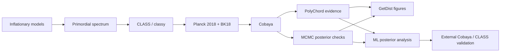
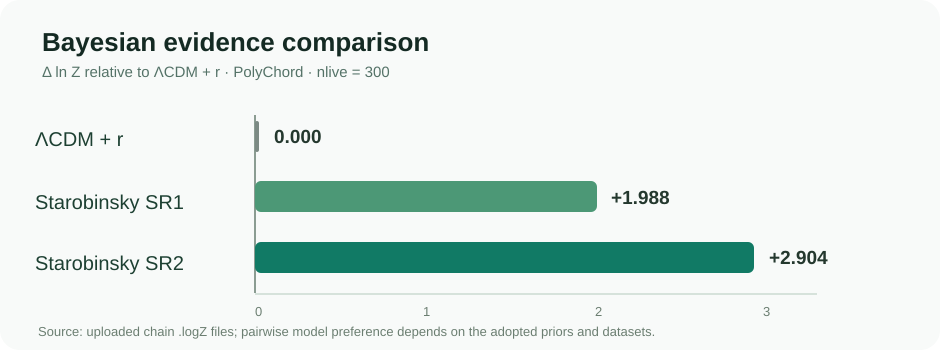
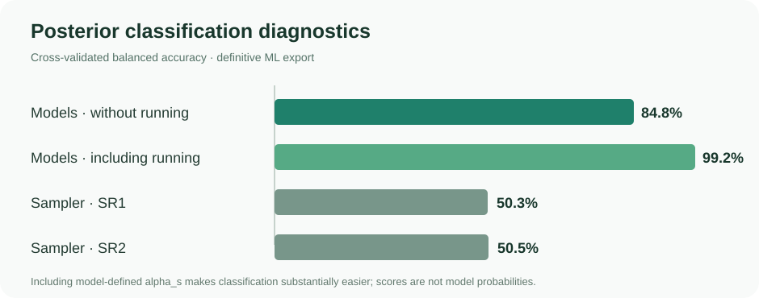
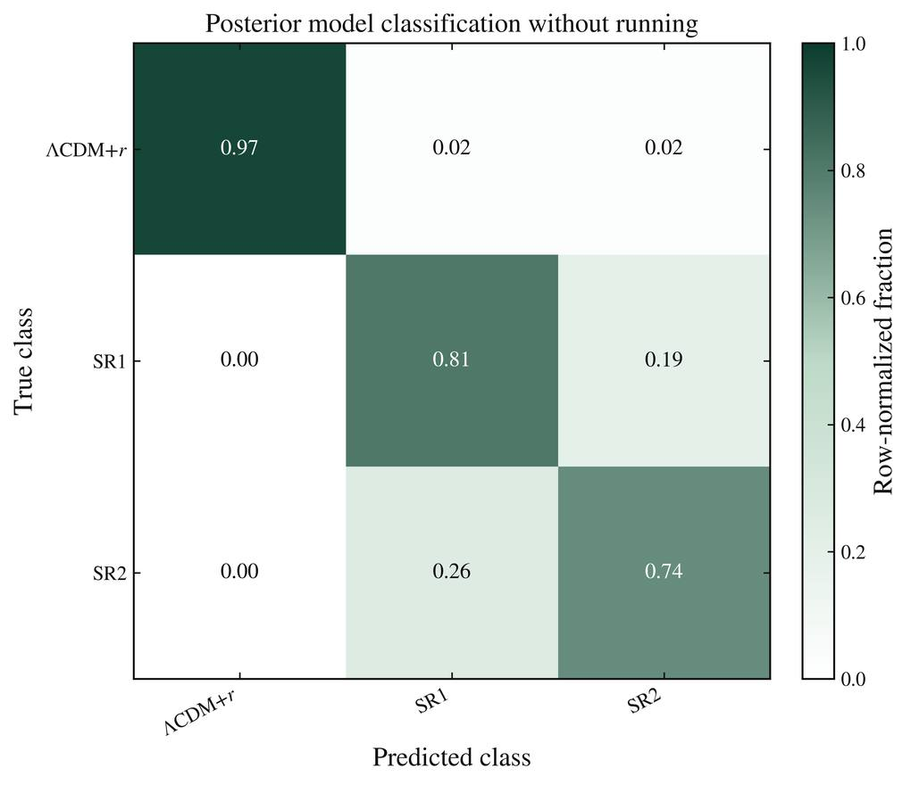
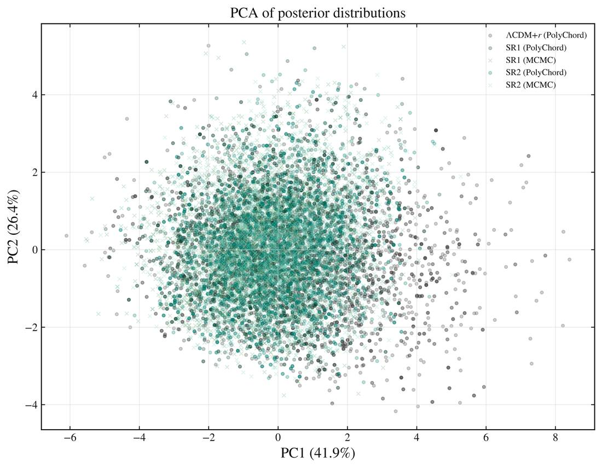
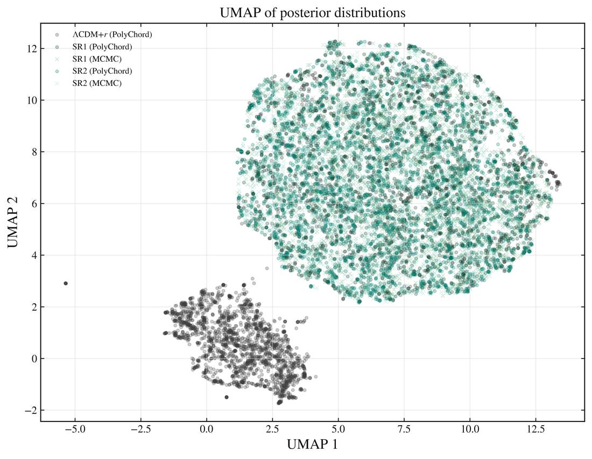
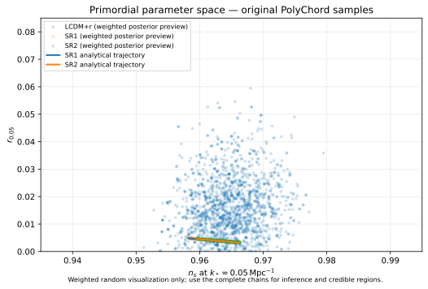

<div align="center">

# Starobinsky Inflation · Bayesian Cosmological Inference
### *Study of the Starobinsky Inflationary Model Using the Cobaya Code*

**Marvin Francisco Jiménez Peñafiel** · Yachay Tech · Physics Thesis (2026)  
Advisor: **Clara Inés Rojas Cely**


**[Research](#research-overview)** · **[Results](#key-results)** · **[Repository map](#repository-map)** · **[Reproduce](#reproduction)** · **[Integrity](#scientific-integrity)**

</div>

---

## Research overview

This project compares two Starobinsky inflationary parameterizations (**SR1** and **SR2**) with a phenomenological flat **ΛCDM + r** reference using the same principal CMB datasets. It combines **Bayesian inference** (Cobaya + CLASS), **nested sampling** (PolyChord), **MCMC convergence analysis**, and an independent **machine-learning** study of posterior geometry and local χ² emulation.



The two slow-roll implementations use a sampled number of e-folds, **50 ≤ N★ ≤ 60**. The final PolyChord comparison used **300 live points per model**. Machine-learning classifiers are diagnostics of posterior separability, **not** substitutes for Bayesian evidence.

## Key results

<div align="center">



</div>

| Model | log evidence ln Z | Statistical uncertainty |
| :--- | ---: | ---: |
| ΛCDM + r | **−797.315749** | 0.274180 |
| Starobinsky SR1 | **−795.327508** | 0.265473 |
| Starobinsky SR2 | **−794.412153** | 0.263564 |

These figures are **read directly from the original `.logZ` files** supplied with the definitive chains, and align with the numerical values in the thesis. Relative to ΛCDM+r, Δln Z ≈ 1.9882 (SR1) and 2.9036 (SR2). The difference SR2–SR1 ≈ 0.9154 is **weak evidence**, not decisive model discrimination.

The uploaded MCMC checkpoints mark SR1 and SR2 as converged at R−1 = 0.00834 and 0.00824 respectively. See [results and integrity](results/README.md) for provenance and limitations.

### Machine-learning diagnostics

<div align="center">



</div>

The definitive exported classification results give **balanced accuracy 0.8479 ± 0.0131** without the model-imposed scalar running and **0.9922 ± 0.0022** with running. Sampler-consistency classifiers for SR1 and SR2 are near **0.50**, consistent with overlapping posterior distributions in the variables examined. High accuracy including deterministic `alpha_s` is primarily a **model-definition diagnostic**, not stronger Bayesian evidence. See [the ML methodology report](machine_learning/outputs/ML_METHODOLOGY_AND_RESULTS.md).

### Selected thesis figures

<table>
<tr>
<td width="33%" align="center"><a href="figures/previews/01_classification/models_PolyChord_without_running/confusion_matrix_normalized.jpg"></a><br><sub>Posterior classification (without running)</sub></td>
<td width="33%" align="center"><a href="figures/previews/04_embeddings/pca_posteriors.jpg"></a><br><sub>PCA posterior geometry</sub></td>
<td width="33%" align="center"><a href="figures/previews/04_embeddings/umap_posteriors.jpg"></a><br><sub>UMAP posterior geometry</sub></td>
</tr>
</table>

<sub>Web-optimized previews of figures supplied in `Graf_ml_definitivo.zip`. Full-resolution originals stay in the source archive. These embedding coordinates are statistical visualization axes, not physical observables.</sub>

### Direct check using the original weighted PolyChord chains

<div align="center">



</div>

This figure is calculated **from the actual weighted `polychord_starobinsky_lcdm.1.txt`, `polychord_starobinsky_SR1_300.1.txt` and `polychord_starobinsky_SR2_300_MPI.1.txt` files** using a deterministic random sample for display. It is an illustrative scatter visualization, not a KDE credible-region estimate. The weighted posterior means and 16th/50th/84th percentiles, computed from *every* row of each original chain, are available in [the machine-readable summary](results/weighted_constraints_original_polychord.csv). To regenerate both outputs, run `python scripts/recalcular_resumen_polychord.py --archives /path/to/ZIPs` after installing NumPy, pandas and Matplotlib.

**Full data preservation:** Original archive hashes are included, but the ZIPs themselves are **not yet in GitHub**. See [the complete Git LFS preparation guide](docs/DATOS_GRANDES_GIT_LFS.md) and the [SHA-256 verifier](scripts/verificar_archivos.py). The CI [scientific consistency checks](.github/workflows/scientific-checks.yml) validate YAML metadata and documented evidence without downloading licensed observational data.

## Repository map

| Directory | Purpose | Provenance |
| :--- | :--- | :--- |
| [`configs/production/`](configs/production) | **Original input YAMLs recovered from final chains** (SR1, SR2, ΛCDM+r; PolyChord and MCMC) | Extracted verbatim |
| [`configs/transcripciones/`](configs/transcripciones) | Configurations from your `Yamls.zip` text notes | Cleaning removes trailing terminal prompts |
| [`analysis/`](analysis) | GetDist figures, convergence checks and model evidence | Original `.py` |
| [`machine_learning/`](machine_learning) | External Cobaya emulator validation and curated ML reports | Original `.py` and exported summaries |
| [`results/`](results) | Evidence derived from supplied `.logZ` outputs | Original numerical output |
| [`data/manifests/`](data/manifests) | Zip inventories, checksums and data provenance | Generated inventory |
| [`data/summaries/`](data/summaries) | Small PolyChord/MCMC metadata and diagnostics | Extracted verbatim |
| [`docs/`](docs) | Installation, HPC execution, configuration audit, reproducibility | Documented |
| [`modelos/`](modelos) | Independent analytical checks | Educational cross-check, not runtime Cobaya |
| [`configs_reconstruidas/`](configs_reconstruidas) | Previous illustrative templates, **not production** | Reconstructed |
| [`slurm/`](slurm) | Example Slurm wrapper pending the original scripts | Template only |

The original exploratory files in the repository root remain intact, including [`effective.py`](effective.py), [`INSTALL_cluster_cobaya.ipynb`](INSTALL_cluster_cobaya.ipynb), and [`polychord_starobinsky_Nfree.yaml`](polychord_starobinsky_Nfree.yaml). **They are not interchangeable with the definitive 300-live-point runs.**

## Reproduction

### 1. Install analysis dependencies

```bash
python -m venv .venv
source .venv/bin/activate
python -m pip install numpy pandas matplotlib getdist pyyaml
```

To recompute cosmological likelihood evaluations you additionally need a compatible **Cobaya, CLASS, PolyChord, MPI, Planck 2018 and BICEP/Keck 2018 installation**, following the software/data providers' requirements. See [cluster installation guide](docs/instalacion-cluster.md) and [reproducibility](docs/REPRODUCIBILITY.md).

### 2. Restore the large chain ZIPs locally

Place the original unmodified archive files alongside this repository (`chains_poly.zip`, `chains_mcmc.zip`, and `chainslcdm.zip`). They are kept **out of ordinary Git history** because they contain large chain sets and restart snapshots. Check hashes against [`data/manifests/archives_sha256.json`](data/manifests/archives_sha256.json).

### 3. Reproduce the figures / evidence analysis

```bash
python analysis/GraficasTesisFinal.py \
  --poly-zip chains_poly.zip \
  --mcmc-zip chains_mcmc.zip \
  --lcdm-zip chainslcdm.zip \
  --out publication_analysis
```

The script outputs GetDist triangle plots, the nₛ–r diagram, MCMC diagnostics, evidence tables, and CSV/LaTeX summaries. **This command has not been run in this GitHub update**, and requires the user-supplied ZIPs.

The supplied ML external-validation program `machine_learning/validar_emulador_cobaya.py` additionally requires `tesis_chain_utils.py`, the candidate CSVs and a functioning likelihood environment; that helper source was **not** among the uploaded source files. See [`machine_learning/README.md`](machine_learning/README.md).

## Scientific integrity

> **Original source versus reconstruction.** The root-level `effective.py` is an earlier exploratory implementation. Its SR2 equations are **not** exactly the same as the definitive sampled-YAML model; the final YAMLs use explicit `lambda N_star` relationships. They have been preserved rather than rewritten. Likewise, the separate exploratory MCMC ΛCDM file includes a lensing-reconstruction likelihood and wider priors; it must not be treated as part of the homogeneous final PolyChord evidence comparison.

- [Audit of all configuration families](docs/CONFIGURATION_AUDIT.md)
- [Reproducibility & data availability](docs/REPRODUCIBILITY.md)
- [Full input inventory and archive checksums](data/manifests/)
- [Results provenance](results/README.md)

### Cite

**Jiménez Peñafiel, M. F. (2026).** *Study of the Starobinsky Inflationary Model Using the Cobaya Code*. Physics thesis, Yachay Tech. Please also cite the Cobaya, CLASS, PolyChord and dataset papers where applicable.
