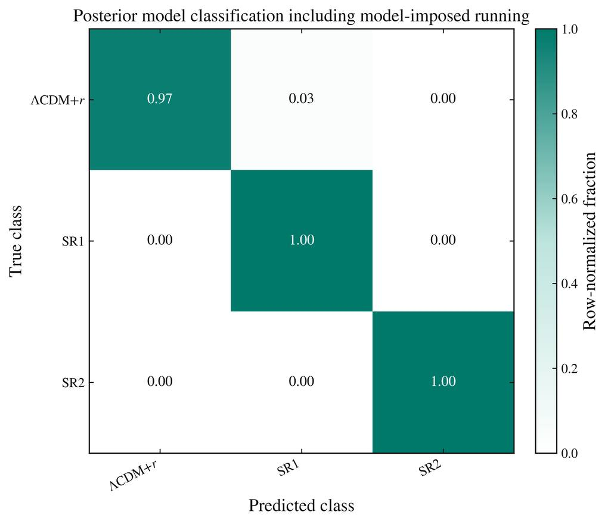
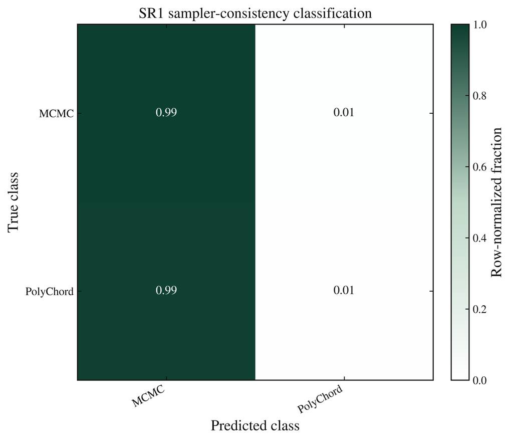
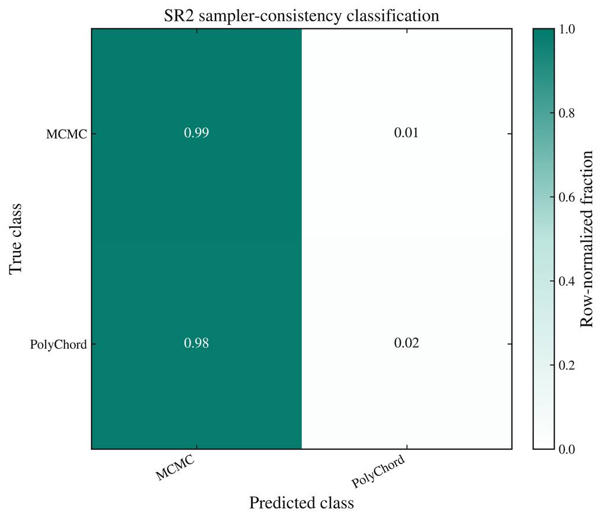
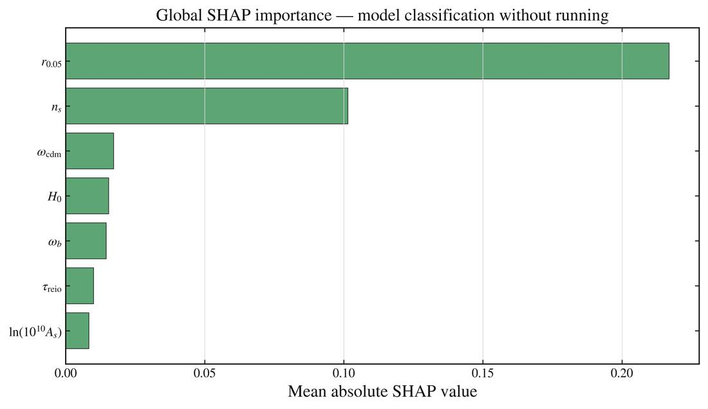
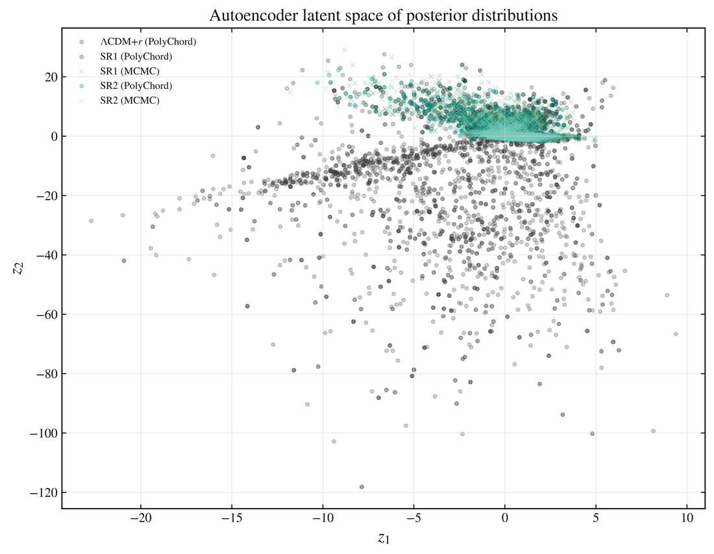
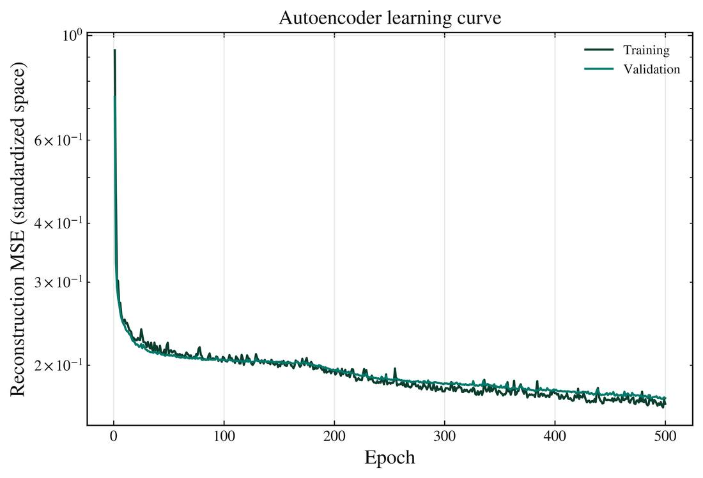

# Thesis figures · ML figure gallery

These **13 web-optimized previews** were resized from the actual `Graf_ml_definitivo.zip` figure outputs supplied with the thesis. They are **not regenerated simulations**; the original full-resolution PNG/PDFs remain in the source ZIP and are indexed in [the archive manifest](../data/manifests/Graf_ml_definitivo.csv). Keep the original files if you need archival print quality.

## Posterior model classification

| Without model-imposed running | With model-imposed running |
|---|---|
|  |  |

Feature importance: [without running](previews/01_classification/models_PolyChord_without_running/permutation_feature_importance.jpg) · [with running](previews/01_classification/models_PolyChord_with_model_imposed_running/permutation_feature_importance.jpg)

> **Methodological caution:** `alpha_s` is fixed/derived differently among models; its inclusion makes the separation partly deterministic. Classification score is not a Bayes factor.

## MCMC versus PolyChord consistency

| SR1 | SR2 |
|---|---|
|  |  |

Feature importance: [SR1](previews/01_classification/sampler_consistency_SR1/permutation_feature_importance.jpg) · [SR2](previews/01_classification/sampler_consistency_SR2/permutation_feature_importance.jpg)

## Explanations

## Dimensionality reduction & neural autoencoder

| PCA | UMAP |
|---|---|
|  |  |

| Autoencoder latent space | Training dynamics |
|---|---|
|  |  |

The plotted embedding coordinates are not cosmological observables. For quantitative information, see [the ML results](../machine_learning/outputs/ML_METHODOLOGY_AND_RESULTS.md) and the source tables under [ML outputs](../machine_learning/outputs).

## Data provenance

Visual previews were derived by opening the user-supplied PNGs, converting them to RGB, resizing to at most 1100×880 px while preserving aspect ratio, and saving optimized JPEGs. All generated preview binary content was SHA-verified on GitHub. Original raw figures were not rewritten.
